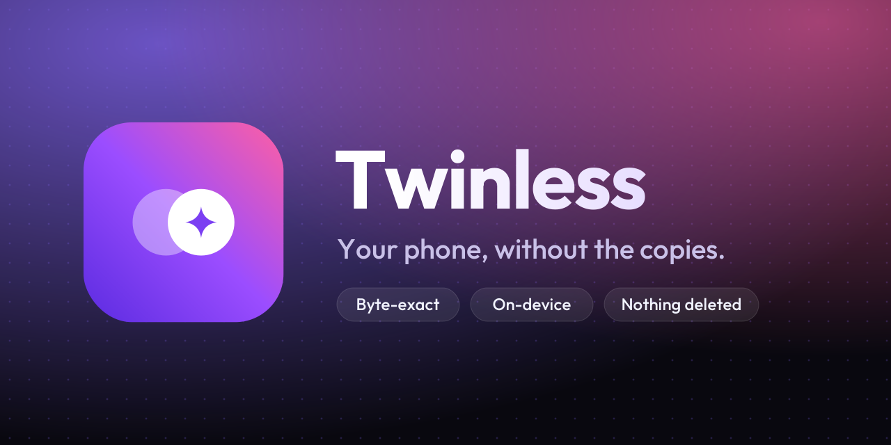
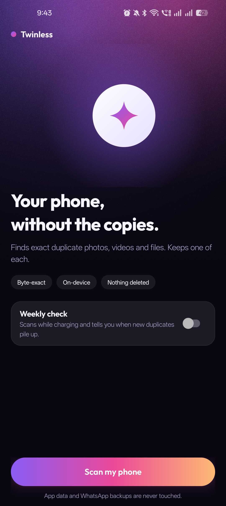
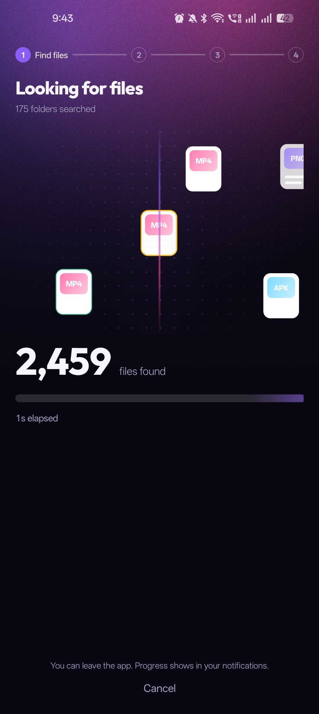
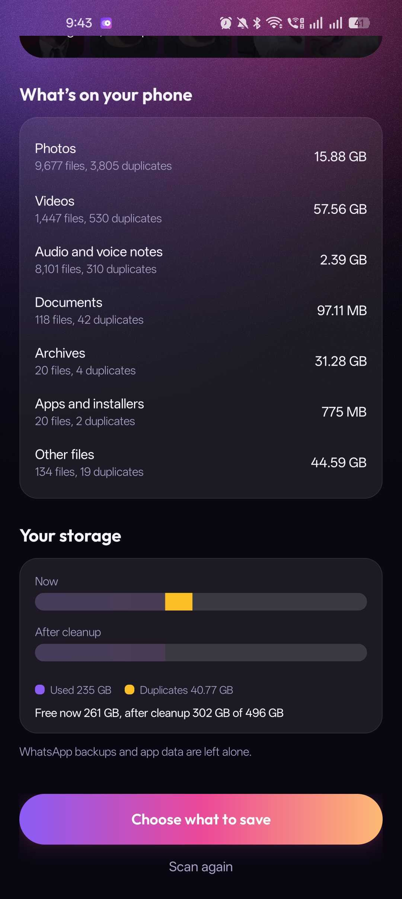

 

<h3>Find every exact duplicate on your phone. Keep one of each. Free up gigabytes.</h3>

---

## ✨ What it does

Twinless scans every folder on your phone (Camera, WhatsApp media, Screenshots, Downloads) and finds files that are **exactly** the same, byte for byte. It saves one clean copy of each into an organised library, checks nothing was missed, and then helps you free the space.

| | |
|---|---|
| 🔍 **Byte-exact matching** | Two files count as duplicates only when every byte is identical. No guessing. |
| 🗂️ **All file types** | Photos, videos, voice notes, PDFs, documents, archives, APKs and more. |
| ✅ **Counter-check** | Every rescan confirms each unique file is in your library. Nothing missed. |
| 🧹 **Free up space** | Moves originals that are safely saved to Twinless Trash. Undo for 30 days. |
| ☑️ **Pick what to keep** | Tap any folder and its photos and files drop down right there. Tick or untick each one. |
| 📊 **Storage chart** | See your storage now and after cleanup. |
| 🌙 **Runs in the background** | Leave the app; progress shows in your notifications and Live Updates. |
| 📅 **Weekly check** | Scans while charging and tells you when new duplicates pile up. |
| ⚡ **Fast rescans** | Remembers files it already checked, so rescans take seconds. |
| 🔒 **Private and safe** | No internet permission at all, so nothing can leave your phone. WhatsApp backups and app data are never touched. |

## 📱 Screenshots

## 🚀 Install

1. Open **[Releases](../../releases/latest)** on your phone and download the newest `.apk`.
2. Open it and allow installs from your browser if Android asks.
   Play Protect may say "unknown app". That's normal for apps outside the Play Store; tap **Install anyway**.
3. Open Twinless, allow **All files access**, and tap **Scan my phone**.

## 🆕 What's new

See **[CHANGELOG.md](CHANGELOG.md)** for every version.

## 🛡️ How it keeps your files safe

- Originals are **never changed**. Twinless only reads them while copying.
- Every copy is **verified byte by byte** against its original.
- Freeing up space only moves files whose library copy matches exactly, and you can **put them back** for 30 days.
- A full report of every duplicate and every skipped file is saved in your library folder.
- The app has **no internet permission**, so it physically can't upload anything.

---

Made with 💜 by Sammy

